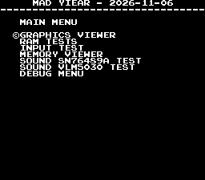
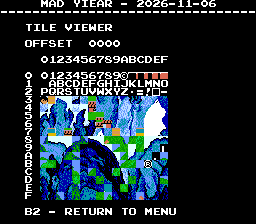
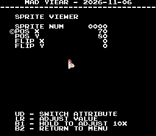
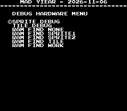
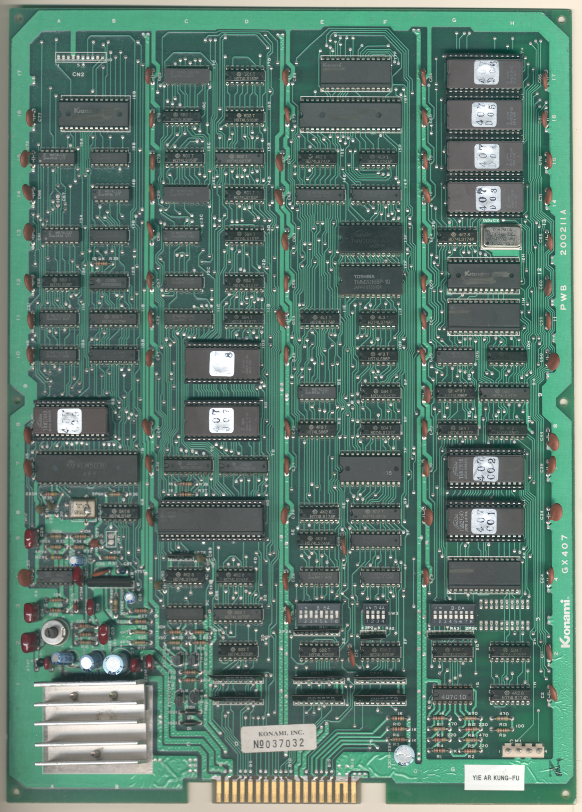
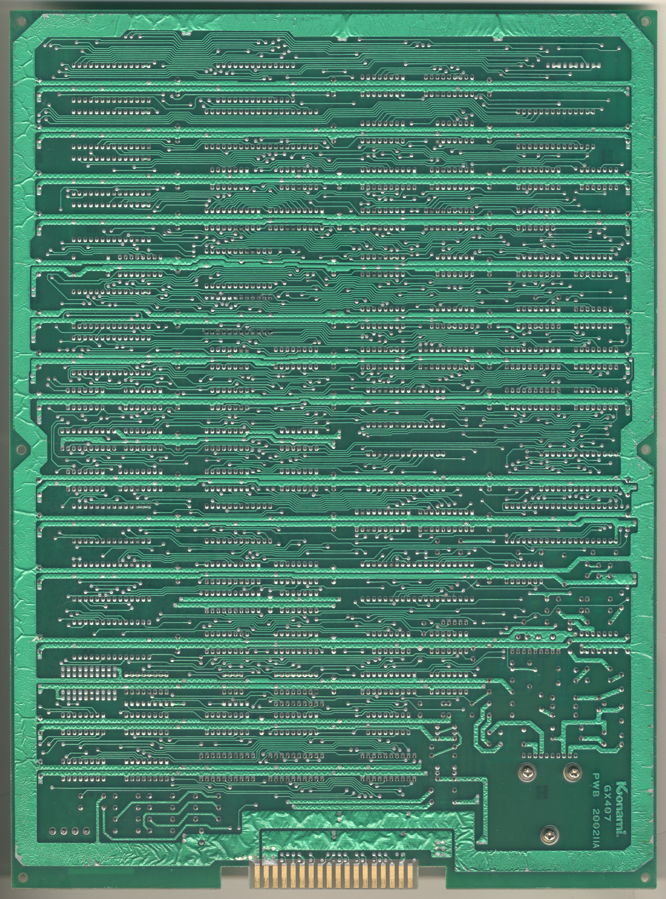

# Yie Ar Kung-Fu
- [MAD Pictures](#mad-pictures)
- [PCB Pictures](#pcb-pictures)
- [Manual / Schematics](#manual-schematics)
- [MAD Eproms](#mad-eproms)
- [RAM Locations](#ram-locations)
- [Errors/Error Codes](#errorserror-codes)
   - [Main CPU](#main-cpu)
   - [Sound CPU](#sound-cpu)
- [MAD Notes](#mad-notes)
   - [Static palette colors](#static-palette-colors)
   - [No Video DAC Test](#no-video-dac-test)
- [MAME vs Hardware](#mame-vs-hardware)

<a name="mad-pictures"></a>
## MAD Pictures

<br>



<a name="pcb-pictures"></a>
## PCB Pictures
<a href="docs/images/yie_ar_kung-fu_pcb_top.png"></a>
<a href="docs/images/yie_ar_kung-fu_pcb_bottom.png"></a>

<a name="manual-schematics"></a>
## Manual / Schematics
[Manual](docs/yie_ar_kung-fu_manual.pdf)<br>
[Schematics](docs/yie_ar_kung-fu_schematics.pdf)

<a name="mad-eproms"></a>
## MAD Eproms
| Diag | Eprom Type | Location | Notes |
| ---- | ---------- | ----------- | ----- |
| Main | 27c128 | 407_i07.8d @ 8D | |

<a name="ram-locations"></a>
## RAM Locations
| RAM | Location | Type | Notes |
| -------- | :------- | ----- | ----- |
| Sprite1 RAM | 13F | TMM2009P-A (2k x 8bit) | |
| Tile RAM | 7F | M58725P-15 (2k x 8bit) | |
| Work RAM | 12F | TMM2009P-A (2k x 8bit) | |

There are 2 additional ram chips (MBM2148-55 1k x 4 bit) located at 14C and 17C
that are not accessible by the CPU.

<a name="errorserror-codes"></a>
## Errors/Error Codes
Error codes play through the VLM5030 IC.

<a name="main-cpu"></a>
### Main CPU
The main CPU is a 6809 CPU. If an error is encountered during tests, MAD will
print the error to the screen, play the beep code, then jump to the error
address

On 6809 CPU the error address is `$f000 | error_code << 4`. Error codes on the
6809 CPU are are 6 bits. Yie Ar Kung-Fu however has a watchdog address that must be
written to periodically or the game will reset.

```
watchdog address: $4f00 = 0100 1111 0000 0000
error address:    $f000 = 1111 00EE EEEE 0000
  E = error code
```
The watchdog address is in conflict with the error address. However instead of
doing a loop to self instruction at the error address, MAD instead does a delay
loop so it stays within the error address range 99.9% of the time and 0.1% of
the time it will ping the watchdog. This is enough for the error addresses to
still be viable to use with a logic probe. It just means address lines not be
100% high or low, but 99% of the time.

<!-- ec_table_main_start -->
| Hex  | Number |     Error Address (A15..A0)    |           Error Text           |
| ---: | -----: | :----------------------------: | :----------------------------- |
| 0x01 |      1 |      1111 0000 0001 xxxx       | SPRITE1 RAM ADDRESS            |
| 0x02 |      2 |      1111 0000 0010 xxxx       | SPRITE1 RAM DATA               |
| 0x03 |      3 |      1111 0000 0011 xxxx       | SPRITE1 RAM MARCH              |
| 0x04 |      4 |      1111 0000 0100 xxxx       | SPRITE1 RAM OUTPUT             |
| 0x05 |      5 |      1111 0000 0101 xxxx       | SPRITE1 RAM WRITE              |
| 0x06 |      6 |      1111 0000 0110 xxxx       | TILE RAM ADDRESS               |
| 0x07 |      7 |      1111 0000 0111 xxxx       | TILE RAM DATA                  |
| 0x08 |      8 |      1111 0000 1000 xxxx       | TILE RAM MARCH                 |
| 0x09 |      9 |      1111 0000 1001 xxxx       | TILE RAM OUTPUT                |
| 0x0a |     10 |      1111 0000 1010 xxxx       | TILE RAM WRITE                 |
| 0x0b |     11 |      1111 0000 1011 xxxx       | WORK RAM ADDRESS               |
| 0x0c |     12 |      1111 0000 1100 xxxx       | WORK RAM DATA                  |
| 0x0d |     13 |      1111 0000 1101 xxxx       | WORK RAM MARCH                 |
| 0x0e |     14 |      1111 0000 1110 xxxx       | WORK RAM OUTPUT                |
| 0x0f |     15 |      1111 0000 1111 xxxx       | WORK RAM WRITE                 |
| 0x3e |     62 |      1111 0011 1110 xxxx       | MAD ROM ADDRESS                |
| 0x3f |     63 |      1111 0011 1111 xxxx       | MAD ROM CRC16                  |

<sup>Table last updated by gen-error-codes-markdown-table on 2026-11-06 @ 21:01 UTC</sup>
<!-- ec_table_main_end -->

<a name="sound-cpu"></a>
### Sound CPU
This board doesn't have a dedicated Sound CPU.  The main CPU handles playing
sounds.

<a name="mad-notes"></a>
## MAD Notes
<a name="mad-notes"></a>
### Static palette colors
There is a single static palette for the txt tiles and one for sprites.  This
makes it impossible to have highlighted text in the memory write handler
(sprite/tile debug screens)

<a name="no-video-dac-test"></a>
### No Video DAC Test
The static palette makes it impossible to do this test.

<a name="mame-vs-hardware"></a>
## MAME vs Hardware
Nothing to warrant different builds.
